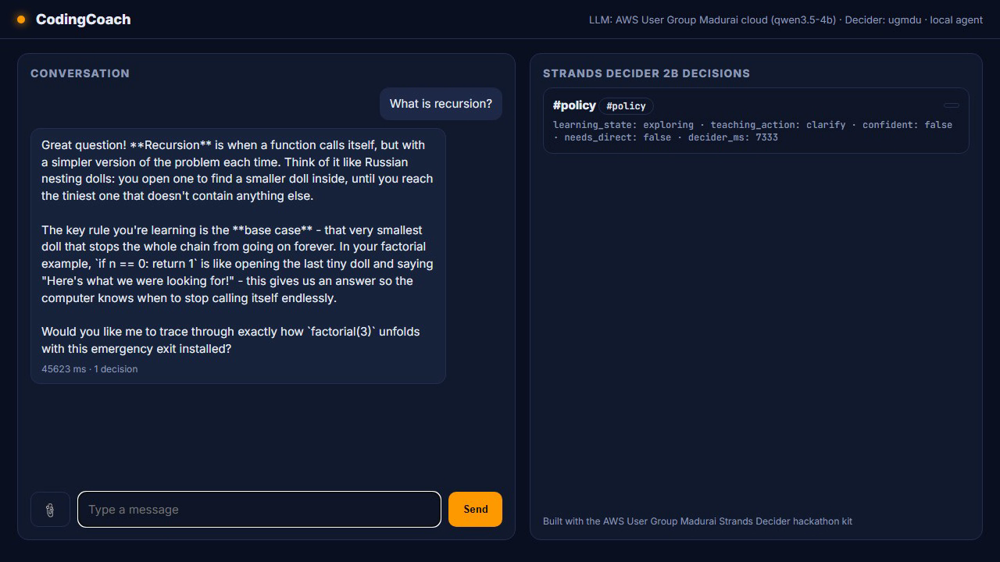
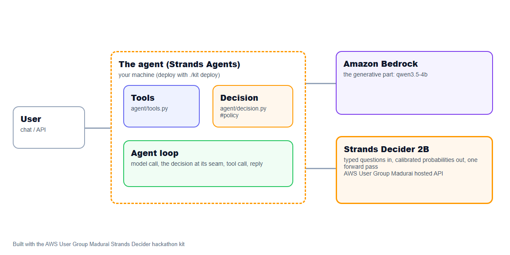

# CodingCoach

**an AI coding tutor that never dumps answers — it reads where you are and asks, hints, or explains just enough.**

An agent on AWS that hands one decision to **Strands Decider 2B** and the conversation to **Amazon Bedrock**. Decision pattern: `#policy`. Tags: `#strands-decider-2b` `#policy`.

- Video: (add the YouTube/Vimeo link)
- Article: (add the AWS Builder Center link)
- Deployed: run `./kit deploy`

## The project

- **Pitch:** an AI coding tutor that never dumps answers — it reads where you are and asks, hints, or explains just enough.
- **Who it is for:** developers learning to code who lose interest or feel like they're not retaining anything when a regular AI just explains everything.
- **Features:**
  - Socratic questioning: asks what you already know before explaining anything
  - Adaptive hints: gives the smallest nudge that moves you forward
  - Challenge generation: creates exercises at your current level
  - Answer checking: tells you what's right before saying what's wrong
  - Deployed on Amazon Bedrock AgentCore Runtime
- **The decision handed to Strands Decider 2B:** before the agent responds, classify the learner's message into a learning state (`exploring`, `attempting`, `stuck`, `demonstrating_understanding`, `off_topic`, `clarification_needed`) and pick the right teaching action. (`#policy`)
- **Why a decision model:** this classification runs on every single message — it must be fast, cheap, and return a confidence the code can branch on (low confidence → ask a clarifying question instead of guessing).
- **Amazon Bedrock:** the conversation and tool use (Amazon Nova Pro by default).



## How it is built

Strands Agents with Amazon Bedrock for the generative part, the tools in `agent/tools.py`, deployed to Amazon Bedrock AgentCore Runtime, and one decision handed to Strands Decider 2B at a clear seam in the agent's path.

Every Amazon Bedrock model id is set in `.env` (`BEDROCK_MODEL_ID`, and `BEDROCK_SMALL/MEDIUM/LARGE_MODEL_ID` for routing), Amazon Nova by default.



## Reusable decision pattern: learner-state policy classification  (#policy)

The pattern lives in [`agent/decision.py`](agent/decision.py), labelled `REUSABLE DECISION PATTERN`. It contains the typed questions and their options, the wiring that puts the decision in the agent's path, and a note on how to reuse it:

```text
REUSABLE DECISION PATTERN: learner-state policy classification  (#policy)

What it does
    Before the coding tutor responds to a learner, Strands Decider 2B reads the conversation
    and classifies the learner's current state:

    - exploring: asking about a new concept they haven't tried yet
    - attempting: actively working on a problem (sharing code or a partial answer)
    - stuck: has tried and hit a wall — explicitly says so or has made multiple failed attempts
    - demonstrating_understanding: showing they understand — correct reasoning or working code
    - off_topic: not related to coding or the current learning session
    - clarification_needed: too ambiguous to classify confidently

    The classification drives the teaching action (ask_question, give_hint, explain_concept,
    generate_challenge, check_answer, redirect, clarify). Low-confidence responses fall back to
    a clarifying question rather than guessing wrong and either spoiling the answer or being
    unhelpfully cryptic.

Typed questions and options
    `learning_state` (choice): six states, each with a one-line definition; see QUESTIONS.
    `needs_direct_explanation` (noul): override — has the learner explicitly asked for a direct
    answer, or struggled so many times that withholding is no longer helpful?

Wiring
    `LearnerStateClassifier` is called once at the start of `HackathonAgent.chat`, before the
    Strands Agent runs. It returns a `TeachingDecision` that is injected into the system prompt
    so the LLM knows exactly how to respond.

        classifier = LearnerStateClassifier(decider)
        td = classifier.classify(message, conversation_history, learner_state)
        # td.teaching_action, td.learning_state, td.confident, td.decider_ms

How to reuse it
    Copy this file, rewrite the six states for your domain (e.g. customer intent in a support
    agent, risk level in a compliance checker), and adjust the action mapping in
    `LearnerStateClassifier.decide()`. The threshold logic (confidence < LOW_CONF → clarify)
    stays the same.
```

Typed questions:

```python
QUESTIONS = {
    "learning_state": Decider.choice(
        "What is the learner's current state in this message?",
        LEARNING_STATES,
    ),
    "needs_direct_explanation": Decider.noul(
        "Has the learner explicitly asked for a direct answer or explanation, or have they struggled with the same concept unsuccessfully multiple times?",
        {
            "true": "the learner said 'just tell me', 'explain it', 'I give up', or has made three or more failed attempts at the same concept",
            "false": "the learner has not asked for a direct answer and has not exhausted their attempts",
        },
    ),
}
```

## Measured

Decider: strands-decider-2b-hobson-v19 (ugmdu). 12 labelled cases, 24 decisions.

| | Strands Decider 2B | qwen3.5-4b |
|---|---|---|
| Accuracy | 87.5% | 87.5% |
| Latency p50 per decision | 4914 ms | 19975 ms |
| Latency p95 | 5480 ms | 20658 ms |
| Cost per 1,000 decisions | $0.0350 | $0.0000 |
| Answered alone at confidence >= 0.7 | 42% | 96% |
| Accuracy when confident | 100.0% | 87.0% |

At the median the decider was 4.1x faster than the LLM.

Reproduce with `./kit bench` (cases in `agent/eval_cases.jsonl`; charts in `submission/bench/`).

## Run it

```bash
./kit setup        # checks your machine and AWS, sets up Strands Decider 2B (local model or hosted API)
./kit demo         # web UI at http://localhost:8501
./kit bench        # the decision vs an Amazon Bedrock LLM
./kit deploy       # Amazon Bedrock AgentCore Runtime
```

Requirements: Python 3.10+, AWS credentials with Amazon Bedrock access, and for deploying, Node 20+ with the AgentCore CLI (`./kit agentcore-cli`).

## Credits

Built with the AWS User Group Madurai Strands Decider hackathon kit (https://github.com/awsugmdu). The kit's reusable library (`decider_kit/`, the demo UI, the video and article tooling, and the Kiro steering, skills and hooks) is the user group's; the agent in `agent/` is mine. Strands Decider: https://github.com/strands-labs/strands-decider (Apache-2.0).

Licence: Apache-2.0 (see LICENSE).
